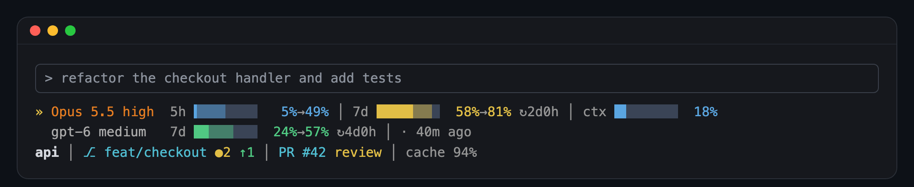

<div align="center">

# paceline

### Pace your agent before the limit hits.

A statusline for Claude Code. It shows where your 5-hour and weekly limits will land at reset, how long you can keep going at your current pace, and your context, git, and pull request state.

It uses only the Python standard library. It makes no network calls and reads no tokens. It also has one line that stays hidden until you turn it on: see [the easter egg](#easter-egg-to-himself).



</div>

```
» Opus 5.5 high       5h █████▒▒▒  63%→105% empty ~38m ↻2h0m │ 7d ██████▒▒  76%→102% ↻1d19h │ ctx ███░░░░░  41%
  gpt-6-astra medium  7d █▒▒▒░░░░  12%→44% │ · 2h0m ago
api │ ⎇ main ●3 ↑1 │ PR #6 review │ cache 92%
```

The block above is the `mono` theme. The `dark` and `light` themes draw the same rows in color. By default paceline picks between them to match your Claude Code theme, as described under [Themes](#themes).

## How to read it

Each agent has its own row. The row starts with the model name and the reasoning effort.

| Segment | Meaning |
|---|---|
| `»` | The paceline mark. Its color follows the highest projected load on the screen. |
| `5h █████▒▒▒ 63%→105%` | The 5-hour limit. The solid part is what you used. The shaded part reaches the projected value at the reset. The projection is the used value divided by the share of the window that has gone. |
| `empty ~38m` | At the burn of the last 10 minutes, you hit the limit in about 38 minutes. It shows only when the projection passes 100% and the limit comes before the reset. |
| `↻2h0m` | Time until the window resets. It shows only when the load is 50% or more. |
| `7d …` | The weekly limit, with the same parts. |
| `ctx ███░░░░░ 41%` | The context window used. |
| `~$1.24` | The session cost. It shows only when Claude Code sends no rate limits, which is the case for API-key users. Claude Code computes it at list price, so it is an estimate. |
| `$ ███▒▒ 63%→88% $314/$500` | The spend limit behind a Claude apps gateway, with its projection. paceline uses a 30-day period when the gateway reports a monthly period or no period. |

Colors climb one ladder for every bar: blue under 50%, green to 70%, amber to 90%, red from 90%. A rate-limit bar takes its color from the projection, so a bar that looks safe now turns red when it is on course to run out.

The identity line shows the folder, the git branch with uncommitted (`●`), ahead (`↑`), and behind (`↓`) counts, the open pull request with its review state, and the prompt cache hit ratio. The branch and the pull request are links in terminals that support OSC 8 links, such as iTerm2, Kitty, and WezTerm.

### The Codex row

If you also use Codex, paceline reads the newest Codex session log under `~/.codex/sessions` and shows a row for it. The reading is as fresh as your last Codex request, so the row ends with its age, for example `· 2h0m ago`. When a Codex window has reset since that reading, the row shows `reset`. The row is hidden when no Codex log exists. Set `CODEX_HOME` if your Codex folder is somewhere else.

### Narrow terminals

paceline reads the terminal width and drops detail until every line fits. The order is: reset countdowns, the runway, projection arrows, then shorter bars, then the cache segment, then the Codex row.

## Easter egg: To Himself

Turn on one setting and paceline adds a line from Marcus Aurelius under its rows. The Greek title of the Meditations is usually given as *To Himself*, and the line uses that name.

```json
{ "quotes": true }
```

The quote follows your 5-hour pace. paceline sorts 40 quotes into four tiers of ten, and picks the tier from the projected 5-hour load. The line takes the color of that load.

| Projected 5-hour load | Tier | Example |
|---|---|---|
| under 50% | Start, blue | To Himself: Confine yourself to the present. |
| 50% to 70% | Center, green | To Himself: Nowhere can a man retreat better than into his own soul. |
| 70% to 90% | Strive, amber | To Himself: Always take the short road; the short road is nature's. |
| 90% and over | Endure, red | To Himself: Be like the headland the waves break on; it stands, the sea falls still. |

A light session gets a push to start. A steady one gets calm. A heavy one gets a reason to keep going, and a session near the limit gets a reason to bear it. Within a tier, a new quote comes every 2 minutes.

The line needs the 5-hour bar, so it shows only on a Pro or Max plan. It hides during the first 6 minutes of a window, before a projection exists, and when it does not fit the terminal width. The text follows the public-domain George Long translation from 1862, with modernized wording.

## Install

Run these commands inside Claude Code:

```text
/plugin marketplace add milaroid/paceline
/plugin install paceline@paceline
/paceline:setup
```

Setup copies paceline to `~/.config/paceline/app/`, or `%APPDATA%\paceline\app\` on Windows. It sets the `statusLine` block in the `settings.json` of the active Claude Code profile and saves the old file as `settings.json.bak`. Restart Claude Code to see the statusline.

If you run more than one profile with `CLAUDE_CONFIG_DIR`, run `/paceline:setup` once in each. All profiles share one copy of paceline.

When the plugin updates, a session-start hook copies the new version into place. You do not need to run setup again.

## Uninstall

```text
/paceline:uninstall
/plugin uninstall paceline@paceline
```

Uninstall puts back the `statusLine` block that the active profile had before setup. It deletes the paceline config folder when no other profile still uses it.

## Settings

Create `~/.config/paceline/config.json`, or `%APPDATA%\paceline\config.json` on Windows. Every key is optional.

```json
{
  "theme": "auto",
  "codex": true,
  "quotes": false,
  "bar_width": 8,
  "countdown_min_load": 50,
  "runway_minutes": 10
}
```

| Key | Default | Meaning |
|---|---|---|
| `theme` | `auto` | `auto`, `dark`, `light`, or `mono`. See [Themes](#themes). |
| `codex` | `true` | Show the Codex row. |
| `quotes` | `false` | Add the [To Himself](#easter-egg-to-himself) line, a Marcus Aurelius quote chosen by the 5-hour load. |
| `bar_width` | `8` | Bar width in cells, from 3 to 20. |
| `countdown_min_load` | `50` | The load in percent at which the reset countdown appears. |
| `runway_minutes` | `10` | How many recent minutes the runway uses to measure your burn, from 2 to 60. |

paceline ignores unknown keys and values outside these ranges.

### Themes

Every text color in `dark` has a contrast ratio of 4.5 or more on black and dark grey backgrounds. Every text color in `light` has the same on white and light grey backgrounds.

With `auto`, paceline reads the `theme` setting of the Claude Code profile that runs it:

| Claude Code theme | paceline palette |
|---|---|
| `light`, `light-daltonized`, `light-ansi` | `light` |
| `dark`, `dark-daltonized`, `dark-ansi` | `dark` |
| `custom:<name>` | The palette of the custom theme's `base` |
| `auto`, or no theme set | A guess at the terminal background, then `dark` |

Claude Code's own `auto` asks the terminal for its background color. A statusline script cannot ask, so paceline guesses. It uses `COLORFGBG` when the terminal sets it. In Apple Terminal, which follows the macOS appearance, it uses that appearance. In any other terminal it uses `dark`. If the guess is wrong, set `theme` to `light` or `dark`.

Use `mono` in terminals without 24-bit color. It draws the bars with glyphs, sends no color codes, and works on any background.

## What paceline reads and writes

paceline reads:
- the JSON that Claude Code sends to the statusline on each refresh,
- `git` state for the current folder, at most once every 5 seconds,
- the tail of the newest Codex session logs, at most once every 10 seconds,
- the effort level in your Claude Code `settings.json`, when Claude Code does not send it.

paceline writes only inside its config folder: `state.json` holds the recent usage readings for the runway and the last Codex reading. `gitcache.json` holds the git state. It makes no network calls and never reads a token or a password.

## Requirements

- Python 3.9 or later. The Python that ships with macOS works.
- Claude Code with statusline support. The 5-hour and weekly bars need a Claude Pro or Max plan. Claude Code sends no rate limits for API-key use.
- macOS, Linux, or Windows.

## Tests

```sh
python3 -m unittest discover -s tests
```

## License

MIT. See [LICENSE](LICENSE).

paceline is an independent project. It is not affiliated with or endorsed by Anthropic or OpenAI. Claude and Claude Code are trademarks of Anthropic. Codex is a trademark of OpenAI.
